<!-- Banner -->
<p align="center">
  
</p>

<p align="center">
  <a href="https://github.com/fahmiphz">
    
  </a>
</p>

<p align="center">
  <a href="https://fahmi-bioorg.vercel.app"></a>
  
</p>

---

## 👋 Tentang Saya

```ts
const fahmi = {
  role: ["Motion Designer", "Creative Web Developer"],
  focus: ["Web 3D interaktif", "Animasi berbasis kode", "UI yang hidup"],
  currentlyBuilding: "SYVA NetLab — simulasi praktikum 3D + asisten suara AI",
  stack: ["TypeScript", "React", "Next.js", "Three.js", "R3F", "Remotion"],
  funFact: "Kontribusi saya diledakin Bomberman tiap hari 💣 (scroll ke bawah)",
};
```

## 🛠️ Tech Stack

<p align="center">
  
</p>

## 🚀 Project Pilihan

<table>
  <tr>
    <td width="50%" valign="top">
      <h3>🧪 <a href="https://github.com/fahmiphz/syva-netlab">SYVA NetLab</a></h3>
      <p>Platform simulasi 3D interaktif berbasis web untuk SMK IT As-Syifa: visualisasi spasial realtime, asisten suara AI <b>SYVA</b>, dan Panel Authoring Guru.</p>
      
      
    </td>
    <td width="50%" valign="top">
      <h3>📼 <a href="https://github.com/fahmiphz/bio-org">Bio-Org</a></h3>
      <p>Halaman link-in-bio bertema rak kaset VHS retro. <a href="https://fahmi-bioorg.vercel.app">Lihat live →</a></p>
      
      
    </td>
  </tr>
  <tr>
    <td width="50%" valign="top">
      <h3>🛡️ <a href="https://github.com/fahmiphz/sentra">Sentra</a></h3>
      <!-- TODO: ganti dengan deskripsi singkat Sentra -->
      <p>Web app Next.js + TypeScript.</p>
      
      
    </td>
    <td width="50%" valign="top">
      <h3>🎬 Motion &amp; 3D</h3>
      <p>Video animasi dari kode pakai <b>Remotion</b> + <b>React Three Fiber</b>, dan model 3D interaktif langsung di browser.</p>
      
      
    </td>
  </tr>
</table>

## 💣 Kontribusi Saya vs Bomberman

<p align="center">
  <picture>
    <source media="(prefers-color-scheme: dark)" srcset="https://raw.githubusercontent.com/fahmiphz/fahmiphz/output/bomberman-contribution-graph-dark.svg">
    <source media="(prefers-color-scheme: light)" srcset="https://raw.githubusercontent.com/fahmiphz/fahmiphz/output/bomberman-contribution-graph.svg">
    
  </picture>
</p>

<details>
  <summary>🕹️ Mau main game lain? Klik di sini</summary>
  <br/>
  <p align="center"><b>👻 Pac-Man</b></p>
  <p align="center">
    <picture>
      <source media="(prefers-color-scheme: dark)" srcset="https://raw.githubusercontent.com/fahmiphz/fahmiphz/output/pacman-contribution-graph-dark.svg">
      <source media="(prefers-color-scheme: light)" srcset="https://raw.githubusercontent.com/fahmiphz/fahmiphz/output/pacman-contribution-graph.svg">
      
    </picture>
  </p>
  <p align="center"><b>🧱 Tetris</b></p>
  <p align="center">
    <picture>
      <source media="(prefers-color-scheme: dark)" srcset="https://raw.githubusercontent.com/fahmiphz/fahmiphz/output/tetris-contribution-graph-dark.svg">
      <source media="(prefers-color-scheme: light)" srcset="https://raw.githubusercontent.com/fahmiphz/fahmiphz/output/tetris-contribution-graph.svg">
      
    </picture>
  </p>
</details>

---

<p align="center">
  <i>“Kalau bisa digerakin, kenapa cuma diem?”</i> 🌀
</p>

<p align="center">
  
</p>
