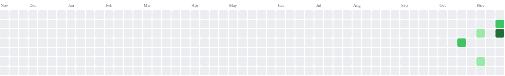

<a href="https://fahmi-bioorg.vercel.app">
  
</a>

<p align="center">
  
</p>

<p align="center">
  <a href="https://fahmi-bioorg.vercel.app"></a>
  
</p>

## 👋 Tentang Saya

```ts
const fahmi = {
  role: ["Motion Designer", "Creative Web Developer"],
  focus: ["Web 3D interaktif", "Animasi berbasis kode", "UI yang hidup"],
  currentlyBuilding: "SYVA NetLab — simulasi praktikum 3D + asisten suara AI",
  stack: ["TypeScript", "React", "Next.js", "Three.js", "R3F", "Remotion"],
  funFact: "Kontribusi saya diledakin Bomberman tiap hari 💣",
};
```

## 🛠️ Peralatan Studio

<p align="center">
  
</p>

## 📼 Rak Kaset Project

<table>
  <tr>
    <td width="50%"><a href="https://github.com/fahmiphz/syva-netlab"></a></td>
    <td width="50%"><a href="https://fahmi-bioorg.vercel.app"></a></td>
  </tr>
  <tr>
    <td width="50%"><a href="https://github.com/fahmiphz/sentra"></a></td>
    <td width="50%"></td>
  </tr>
</table>

## 🕹️ Insert Coin — Kontribusi vs Bomberman

<p align="center">
  <picture>
    <source media="(prefers-color-scheme: dark)" srcset="https://raw.githubusercontent.com/fahmiphz/fahmiphz/output/bomberman-contribution-graph-dark.svg">
    <source media="(prefers-color-scheme: light)" srcset="https://raw.githubusercontent.com/fahmiphz/fahmiphz/output/bomberman-contribution-graph.svg">
    
  </picture>
</p>

<details>
  <summary>👾 Ganti kaset game — Pac-Man &amp; Tetris</summary>
  <br/>
  <p align="center"><b>👻 Pac-Man</b></p>
  <p align="center">
    <picture>
      <source media="(prefers-color-scheme: dark)" srcset="https://raw.githubusercontent.com/fahmiphz/fahmiphz/output/pacman-contribution-graph-dark.svg">
      <source media="(prefers-color-scheme: light)" srcset="https://raw.githubusercontent.com/fahmiphz/fahmiphz/output/pacman-contribution-graph.svg">
      
    </picture>
  </p>
  <p align="center"><b>🧱 Tetris</b></p>
  <p align="center">
    <picture>
      <source media="(prefers-color-scheme: dark)" srcset="https://raw.githubusercontent.com/fahmiphz/fahmiphz/output/tetris-contribution-graph-dark.svg">
      <source media="(prefers-color-scheme: light)" srcset="https://raw.githubusercontent.com/fahmiphz/fahmiphz/output/tetris-contribution-graph.svg">
      
    </picture>
  </p>
</details>

<p align="center">
  <sub>■ STOP · <i>“Kalau bisa digerakin, kenapa cuma diem?”</i> · ⏏ EJECT</sub>
</p>
